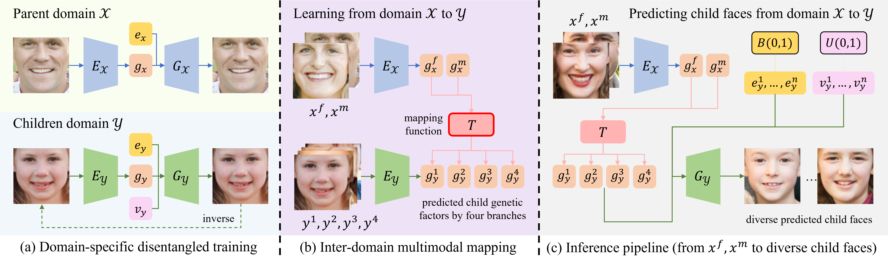
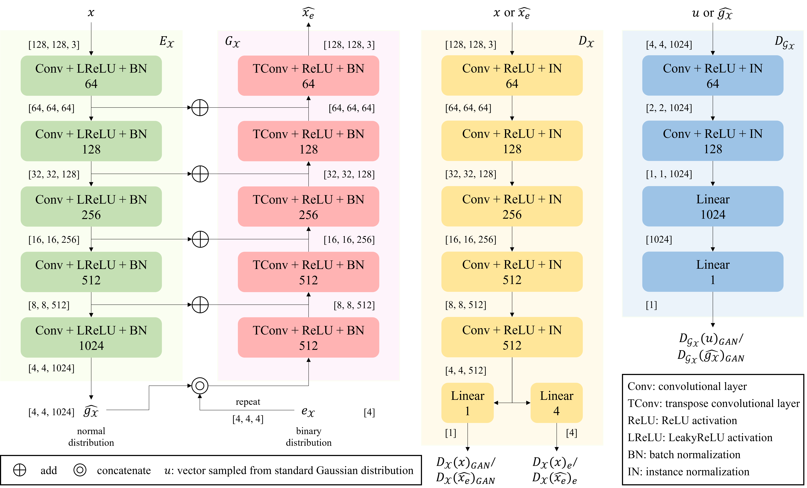
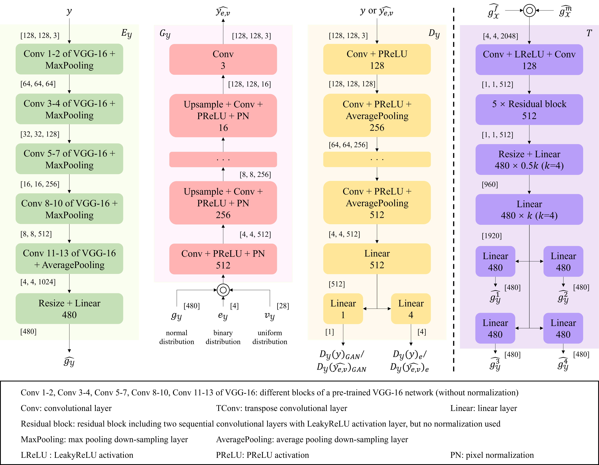

# ChildPredictor

Esta es la página web oficial del artículo "ChildPredictor: A Child Face Prediction Framework with Disentangled Learning", aceptado en IEEE TMM, 2022

Arxiv: https://arxiv.org/abs/2204.09962

IEEE Xplore: https://ieeexplore.ieee.org/document/9749880

:rocket:  :rocket:  :rocket: **Noticias**:

- **19 de mayo de 2022**: Publicamos los datos de FF-Database. Consulte la sección 1.1 para los términos de uso.

- **15 de abril de 2022**: Publicamos los modelos preentrenados con muestras de validación para ChildPredictor.

- **31 de marzo de 2022**: El artículo ha sido aceptado por IEEE Transactions on Multimedia.

- **8 de febrero de 2022**: Publicamos el código para ChildPredictor. Estamos considerando publicar los datos originales de FF-Database recopilado.

## 1 FF-Database

### 1.1 Descarga de Datos

Si desea descargar los datos de FF-Database, complete un acuerdo con los [Términos de Uso de FF-Database](./FF-Database-TOU.pdf) y envíenoslo a yzzhao2-c@my.cityu.edu.hk.

Utilice un correo electrónico institucional en lugar de direcciones anónimas como Gmail, QQMail o hotmail. Asegúrese de que su dirección de correo electrónico sea la misma que la que figura en los **Términos de Uso de FF-Database**.

### 1.2 Descripción General

El proceso de recopilación de datos se muestra a continuación:


Se muestran algunas familias a continuación:


## 2 Resultados en Familias Reales

Los resultados generados en FF-Database recopilado:


Los resultados generados en otros conjuntos de datos:


El análisis del aprendizaje desacoplado es el siguiente:


El estudio de ablación es el siguiente:


## 3 Implementación

### 3.1 Estructura de Archivos

Algunos archivos no están incluidos en la implementación actual porque son demasiado grandes. Las arquitecturas de red se pueden encontrar en la carpeta ``code``.

```
code
│
└───baby_model_pool
│   └───attgan
│   │   │   attgan_without_claloss_baby.pth
│   │   │   attgan_without_ganloss_celeba_baby.pth
│   │   │   attgan_without_ganloss_claloss_celeba_baby.pth
│   │   │   ...
│   └───inverse
│   │   │   Inverse_ProGAN_GAN_ACGAN_start-with-code.pth
│   │   │   Inverse_ProGAN_GAN_MSGAN_ACGAN_start-with-code.pth
│   │   │   Inverse_ProGAN_GAN_MSGAN_ACGAN_start-with-image.pth
│   │   │   ...
│   └───mapping
│   │   └───Mapping_Xencoder_full_ProGAN_GAN_MSGAN_ACGAN_deepArch_multi-gt_v4
│   │   │   │   MappingNet_Batchsize_32_Epoch_298.pth
│   │   └───Mapping_Xencoder_full_ProGAN_GAN_deepArch_multi-gt_v4
│   │   │   │   MappingNet_Batchsize_32_Epoch_298.pth
│   │   └───Mapping_Xencoder_wo-class_ProGAN_GAN_MSGAN_deepArch_multi-gt_v4
│   │   │   │   MappingNet_Batchsize_32_Epoch_298.pth
│   │   │   ...
│   └───ProGAN-ckp
│   │   │   ProGAN_pt_mixtureData_GAN.pth
│   │   │   ProGAN_pt_mixtureData_GAN_ACGAN.pth
│   │   │   ProGAN_pt_mixtureData_GAN_MSGAN.pth
│   │   │   ProGAN_pt_mixtureData_GAN_MSGAN_ACGAN.pth
│   │   │   ...
│
└───babyinverse (Ey)
│   │   ...
|
└───babymapping_1219 (T)
│   │   ...
│
└───Datasets
│   │   ...
│
└───ProGAN (Gy)
│   │   ...
│
└───AttGAN (please refer to AttGAN official webpage)
│   │   ...
│   
```

### 3.2 Bibliotecas Requeridas

La implementación se basa en CUDA 9.0 y PyTorch 1.1.0. Se necesitan instalar los siguientes paquetes:

```bash
pytorch==1.1.0
torchvision==0.3.0
tensorflow-gpumkdir ./babymapping_1219/Models/pretrain
mv ./baby_model_pool/ProGAN-ckp/* ./babymapping_1219/Models/pretrain/
tensorboardx
pyyaml
tqdm
easydict
```

### 3.3 Prueba de un Rostro Real

En primer lugar, descargue los modelos preentrenados desde este enlace:

- Enlace: https://pan.baidu.com/s/16Kf79fVyJxOHwfaXfH2Pzg?pwd=qwua

- Código: qwua

Debería ser un archivo zip grande de aproximadamente 3.9 GB.

Una vez que haya descargado los modelos preentrenados, ingrese a la carpeta `code` y descomprima todos los modelos bajo la carpeta **./code/baby_model_pool**:

```
cd code
mkdir baby_model_pool
cd baby_model_pool
unzip Onedrive_baby_model_pool.zip
cd ..
```

Luego, debe mover todos los modelos preentrenados de ProGAN a otra ruta:

```
mkdir ./babymapping_1219/Models/pretrain
mv ./baby_model_pool/ProGAN-ckp/* ./babymapping_1219/Models/pretrain/
```

A continuación, puede probar algunas muestras de validación (ya hemos colocado algunos ejemplos en la carpeta **code/babymapping_1219**):

```bash
cd babymapping_1219
python main.py
```

Si desea cambiar las imágenes de entrada, consulte las líneas 38-39 de **validation.yaml**: https://github.com/zhaoyuzhi/ChildPredictor/blob/main/code/babymapping_1219/yaml/yaml/validation.yaml#L38-L39

### 3.4 Entrenamiento

Actualmente, no publicamos el código completo para el entrenamiento debido a problemas de privacidad.

### 3.5 Construya su Propio Conjunto de Datos

Consulte **code_FFDatabase_collection**.

## 4 Arquitecturas de Red







## 5 Trabajos Relacionados

- Zaman, Ishtiak and Crandall, David. Genetic-GAN: Synthesizing Images Between Two Domains by Genetic Crossover. European Conference on Computer Vision Workshops, 312--326, 2020.

- Gao, Pengyu and Robinson, Joseph and Zhu, Jiaxuan and Xia, Chao and Shao, MIng and Xia, Siyu. DNA-Net: Age and Gender Aware Kin Face Synthesizer. IEEE International Conference on Multimedia and Expo (ICME), 2021.

- Robinson, Joseph Peter and Khan, Zaid and Yin, Yu and Shao, Ming and Fu, Yun. Families in wild multimedia (FIW MM): A multimodal database for recognizing kinship. IEEE Transactions on Multimedia, 2021.

## 6 Citación

Si encuentra este trabajo útil para su investigación, cite:

```bash
@article{zhao2022childpredictor,
  title={ChildPredictor: A Child Face Prediction Framework with Disentangled Learning},
  author={Zhao, Yuzhi and Po, Lai-Man and Wang, Xuehui and Yan, Qiong and Shen, Wei and Zhang, Yujia and Liu, Wei and Wong Chun-Kit and Pang, Chiu-Sing and Ou, Weifeng and Yu, Wing-Yin and Liu, Buhua},
  journal={IEEE Transactions on Multimedia},
  year={2022}
}
```

Contacte a yzzhao2-c@my.cityu.edu.hk para más preguntas.
